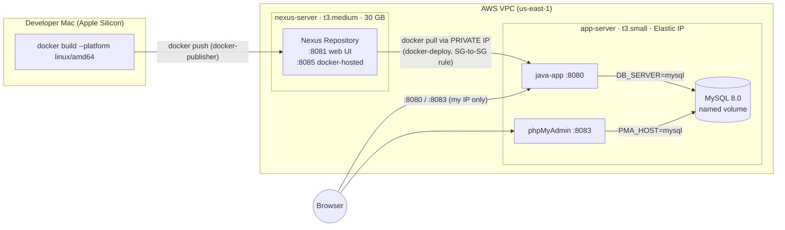

# Cloud-to-Container Pipeline

An end-to-end DevOps project that takes applications from **source code → versioned artifact → container image → running on AWS**, with least-privilege access at every step and no secrets in Git.

| Phase | Focus | Outcome |
|---|---|---|
| 1 | Cloud server | Node.js app deployed on AWS EC2, locked down by security groups |
| 2 | Artifact management | Nexus repositories with per-team access and a scripted deploy from the Nexus REST API |
| 3 | Containerised deployment | Java + MySQL + phpMyAdmin run on EC2 from one `docker compose up`, with the app image pulled from a self-hosted Nexus Docker registry |

---

## Architecture



---

## Repository layout

```
cloud-container-pipeline/
├── developer-projects/
│   ├── app/                    # Node.js app (Phases 1–2)
│   └── scripts/
│       └── fetch-and-run.sh    # pulls the newest artifact from Nexus and runs it
├── java-mysql-app/             # Java + MySQL app (Phase 3)
│   ├── Dockerfile              # multi-stage, non-root
│   ├── .dockerignore
│   ├── docker-compose.yaml     # app + mysql + phpmyadmin
│   ├── .env.example            # variable names only, no real values
│   └── src/ …
├── .gitignore                  # node_modules/, *.tgz, .env, .DS_Store
└── README.md
```

---

## Phase 1: Cloud server (AWS EC2)

- Deployed the Node.js app to an EC2 instance.
- Inbound access is limited to **my own IP** (`/32`), never `0.0.0.0/0` (the whole internet).
- Lesson: home broadband IPs change, so "My IP" rules need refreshing. That's one reason teams use a VPN or bastion host with a fixed IP.

---

## Phase 2: Artifact management (Nexus)

**Why:** servers should run a **finished, versioned build**, not rebuild from source. Built packages (`.tgz`, `.jar`) don't belong in Git, so they live in an artifact repository.

### Least-privilege access

| User | Repository | Access |
|---|---|---|
| `team1` (Node team) | `npm-hosted` (own blob store `npm-blob`) | add / edit / read / browse |
| `team2` (Java team) | `maven-snapshots` | add / edit / read / browse |
| `deploy-user` | both | **read / browse only** |

- Every role uses Nexus **view** privileges (access to repo *contents*), never **admin** privileges (access to repo *configuration*).
- **Tested, not assumed:** `deploy-user` downloads fine but gets **403** when it tries to upload.

### Deploy script: `developer-projects/scripts/fetch-and-run.sh`

1. Refuses to run unless `NEXUS_PASS` is set in the environment. No credentials in code.
2. Queries the Nexus REST API for `npm-hosted`, sorted **newest version first**.
3. Extracts the download URL with `jq`, and stops if the repo is empty.
4. Downloads it as the read-only user into a fresh working folder.
5. Unpacks, runs `npm install --omit=dev`, and starts the app.

Safety: `set -euo pipefail` (stop on any error, unset variable or failed pipe), and `curl -f` (an HTTP error stops the script instead of saving an error page as the artifact).

### Result: fixing what shipped to production

The first scripted deploy installed 372 packages for a small Express app, because the test framework (`jest`) was listed as a runtime dependency. I moved it to `devDependencies` and limited the package to runtime files with `"files"`:

| | v1.0.1 | v1.0.2 |
|---|---|---|
| Packages installed | 372 | **65** (−82%) |
| Vulnerabilities | 19 | **0** |
| Install time | 15s | **2s** |

The script picked up v1.0.2 **by itself**, which also proved the "newest version" logic.

---

## Phase 3: Containerised deployment (Docker)

### Configuration through environment variables
The app reads `DB_USER`, `DB_PWD`, `DB_SERVER` and `DB_NAME`, never hard-coded values. The same image runs on a laptop and on a server; only the `.env` changes.

### Dockerfile: multi-stage and non-root
- **Build stage:** `gradle:8-jdk17` compiles the jar.
- **Run stage:** `eclipse-temurin:17-jre`, with only the runtime and the jar. Gradle and the JDK never ship.
- Runs as **`appuser`, not root**. Checked with `docker exec <container> whoami`.
- `.dockerignore` keeps `.env` out of the image, so passwords can't be baked in.

### Docker Compose
- **MySQL** with a **named volume**, so data survives `docker compose down` / `up`.
- A **healthcheck** (`mysqladmin ping`), with `depends_on: condition: service_healthy`, so the app only starts once MySQL actually answers, not just once its container has started.
- Containers find each other by **service name** (`DB_SERVER=mysql`, `PMA_HOST=mysql`). Inside a container, `localhost` means that container itself.
- Every value comes from `.env` (git-ignored). `.env.example` documents the variable names.

### Private registry flow
1. Build for the server's chip type on an Apple Silicon Mac: `docker build --platform linux/amd64`.
2. Push to the Nexus `docker-hosted` repo on port **8085** as **`docker-publisher`** (push rights only).
3. The app server pulls as **`docker-deploy`** (read only) through Nexus's **private IP**. The `nexus-sg` rule allows port 8085 from `app-sg` (security-group-to-security-group), so no public path is needed.
4. Both Docker clients mark the registry as `insecure-registries`, because Nexus serves plain HTTP. In production you'd put HTTPS in front of it.

### Running it
```bash
# on the app server
cp .env.example .env && nano .env && chmod 600 .env
docker login <nexus-private-ip>:8085      # docker-deploy
docker compose up -d
docker compose ps                         # mysql (healthy) → java-app Up
```
App: `http://<app-server-ip>:8080` · phpMyAdmin: `http://<app-server-ip>:8083`

---

## Debugging log

Real problems hit during the build, how each was diagnosed, and the fix.

| Symptom | Diagnosis | Fix |
|---|---|---|
| SSH timed out to a new instance | The "My IP" rule had filled in my **IPv6** address; SSH connects over IPv4 | Replaced it with an IPv4 `/32` rule (AWS won't convert a rule, so delete and re-add) |
| `docker login` → **403**, all permissions looked right | `curl localhost:8085/v2/` **on the Nexus server** returned `000`: **nothing was listening** on 8085. The 403 came from Docker Desktop's proxy, not Nexus | Saved the HTTP connector (port 8085) on the `docker-hosted` repo. Lesson: test from the inside out |
| App server timed out pulling from Nexus | The 8085 rule had been added to `app-sg`. Inbound rules belong on the server **receiving** the connection | Added the 8085 rule to `nexus-sg` with source `app-sg` |
| Push timed out on the largest layer | Nexus root disk was the **8 GB default and 69% full** | Grew the EBS volume to 30 GB **with the server running**: `growpart` → `resize2fs` |
| Push failed: "not authorized" after layers uploaded | The Mac was logged in as the **pull-only** `docker-deploy` user: it could read but not upload | `docker logout`, then `docker login -u docker-publisher` |
| Everything broke after a stop/start | The instances got **new public IPs**; the old ones were in image tags and settings | Elastic IP for the app server. Server-to-server traffic uses private IPs, which don't change |
| App image was built but contained the wrong host | `sed` replaced nothing, and `grep` printed nothing; Docker reused every cached layer | Checked `grep` output before building; new content means a new tag (`1.2` → `1.3`) |
| `UnknownHostException: null` | The `DB_*` variables weren't exported in that terminal session | Set them again in the session; later moved everything into `.env` |
| Upload commits occasionally time out | Small Nexus instance is slow to confirm large layers; the layer is actually saved | Retry, and use `max-concurrent-uploads: 1` |

---

## Security choices

- **No secrets in Git:** `.env` is git-ignored, credentials live in the environment or home-directory config (`~/.m2/settings.xml`, `~/.npmrc`), and `.env.example` holds placeholders only.
- **Least privilege everywhere:** separate users for publishing and for deploying, per team and per repo.
- **Containers run as non-root.**
- **Network:** admin ports allow only my IP, and server-to-server traffic uses private IPs with SG-to-SG rules.
- **Known trade-offs (lab only):** the registry uses plain HTTP, and `docker login` stores credentials unencrypted on the server. In production: HTTPS on the registry, a credential helper, or ECR with an IAM role.

---

## Cost hygiene
- Stop both instances when not in use.
- **Elastic IPs charge until released.** When finished: disassociate → release, then terminate the instances.

---

## Tech
AWS (EC2, EBS, security groups, Elastic IP) · Linux · Bash · Node.js / npm · Java / Gradle / Maven · Sonatype Nexus Repository · Docker · Docker Compose · MySQL · Git
